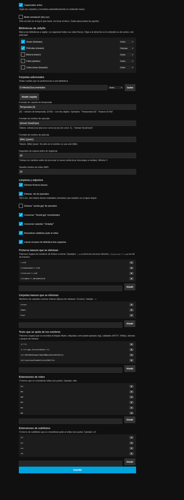

# Media Organizer para Jellyfin

Plugin para **Jellyfin 12.x (net10.0)** que normaliza automáticamente los nombres
de carpetas y ficheros de tus bibliotecas de **series** y **películas**, para que
Jellyfin pueda descargar sus metadatos correctamente.

Convierte nombres típicos de trackers:

```
Ataque a los Titanes - Temporada 1 [HDTV][Cap.101][Castellano][www.descargas2020.org].avi
The.Boys.S05E08.FINAL.MULTI.1080p.WEB.H264-HiggsBoson/
```

en la estructura estándar de Jellyfin:

```
Ataque a los Titanes/Temporada 1/Ataque a los Titanes S01E01.avi
The Boys/Temporada 5/The Boys S05E08.mkv
```



## Qué hace

- **Vigila** las carpetas que configures (raíz de Series, de Películas…). Cuando
  entra un fichero o carpeta nuevo, espera a que la copia/descarga termine
  (tiempo de asentamiento configurable) y lo organiza.
- **Reconoce episodios** en los formatos habituales: `S01E02`, `s1e5`, `1x05`,
  `Cap.101`, `Cap.201`, `cap.408`, `Temporada 3`…
- **Limpia el nombre**: quita `[www.ejemplo.org]`, etiquetas de calidad
  (`HDTV`, `1080p`, `x265`…), idiomas (`Castellano`…) y grupos de release
  (`-CROOKS`, `-HiggsBoson`, `-Me7alh`…).
- **Series** → `Serie/<Temporada N>/Serie SxxEyy.ext`
  **Películas** → `Título (año)/Título (año).ext`
- **Aplana** las carpetas de un solo episodio (`[HDTV][Cap.301][...]/`) metiendo
  el vídeo en su temporada.
- **Mueve los adjuntos** renombrándolos igual que el vídeo: `-thumb.jpg`,
  `.trickplay` y subtítulos (`.srt`, `.ass`, `.vtt`…).
- **Elimina la basura**: `.url`, `Downloaded from *.txt`, carpetas
  `Screens`/`Sample`/`Proof`, y opcionalmente `.nfo` y `-poster.jpg` de episodios.
- **Desmonta las carpetas vacías** que quedan tras mover los vídeos.
- Opcionalmente **lanza un escaneo de biblioteca** de Jellyfin al terminar.
- **Modo simulación (dry-run)**: registra en el log lo que haría sin tocar nada.
- Incluye una **tarea programada** ("Media Organizer: normalizar carpetas
  vigiladas") como red de seguridad, por si algún evento del sistema de
  ficheros se pierde.

## Instalación

1. Compila el plugin (o usa la DLL de una release):

   ```powershell
   dotnet build -c Release
   ```

2. Copia `bin\Release\net10.0\Jellyfin.Plugin.MediaOrganizer.dll` a la carpeta de
   plugins de tu servidor Jellyfin:

   ```
   %LOCALAPPDATA%\jellyfin\plugins\MediaOrganizer\Jellyfin.Plugin.MediaOrganizer.dll
   ```

   (en Docker: `<config>/plugins/MediaOrganizer/`)

3. **Reinicia Jellyfin** y entra en el panel:
   `Panel de control → Media Organizer`.

4. Elige los **orígenes** que quieres vigilar:
   - Marca una o varias **bibliotecas de Jellyfin** y elige a la derecha si son
     de series o de películas (se organizan todas sus rutas físicas).
   - O añade **carpetas adicionales** con su ruta y su tipo.

5. Guarda. Activa el **dry-run** primero si quieres ver en el log
   (`log/log_*.log`, prefijo `[MediaOrganizer]`) qué renombres haría antes de
   aplicarlos de verdad.

## Configuración

| Opción | Por defecto | Descripción |
|---|---|---|
| Organizador activo | ✔ | Activa/desactiva toda la lógica |
| Modo simulación | ✘ | Solo registra en el log |
| Bibliotecas | ninguna | Bibliotecas de Jellyfin a vigilar + tipo (Series/Películas) |
| Carpetas adicionales | ninguna | Rutas sueltas fuera de bibliotecas, con su tipo |
| Formato carpeta temporada | `Temporada {0}` | `{0}` = nº, `{0:00}` = dos dígitos |
| Formato episodio | `{show} S{ss}E{ee}` | `{show}`,`{ss}`,`{ee}`,`{s}`,`{e}` |
| Formato película | `{title} ({year})` | `{title}`,`{year}` (sin año → solo título) |
| Espera (segundos) | `30` | Tiempo sin cambios antes de procesar |
| Tamaño mínimo (MB) | `20` | Ignora vídeos más pequeños (samples) |
| Eliminar basura | ✔ | Patrones regex configurables |
| Eliminar .nfo episodios | ✘ | Bórralos si traen metadatos obsoletos |
| Eliminar -poster episodios | ✘ | Jellyfin solo usa `-thumb` en episodios |
| Conservar -thumb | ✔ | Renombra `<nuevo>-thumb.jpg` |
| Conservar .trickplay | ✔ | Renombra `<nuevo>.trickplay` |
| Renombrar subtítulos | ✔ | `.srt`, `.ass`, `.ssa`, `.sub`, `.vtt`, `.idx` |
| Escaneo de biblioteca | ✔ | `QueueLibraryScan` tras organizar |

Los **patrones de limpieza** (regex, uno por línea) y las **carpetas basura**
(separadas por `;`) son editables desde la página de configuración.

## Notas

- Es **idempotente**: un fichero ya bien nombrado no se vuelve a tocar, y nunca
  sobrescribe un destino existente (lo registra en el log).
- Si un nombre no se puede interpretar (sin token de episodio ni título claro),
  el plugin **lo deja como está** y lo anota en el log.
- Los cambios en "carpetas vigiladas" se aplican al instante (los watchers se
  reconstruyen al guardar la configuración).

## Compilación

Requiere el **.NET 10 SDK** (el servidor Jellyfin 12.x corre sobre .NET 10):

```powershell
dotnet build -c Release
```

## Licencia

GPL-2.0 — ver [LICENSE](LICENSE).
